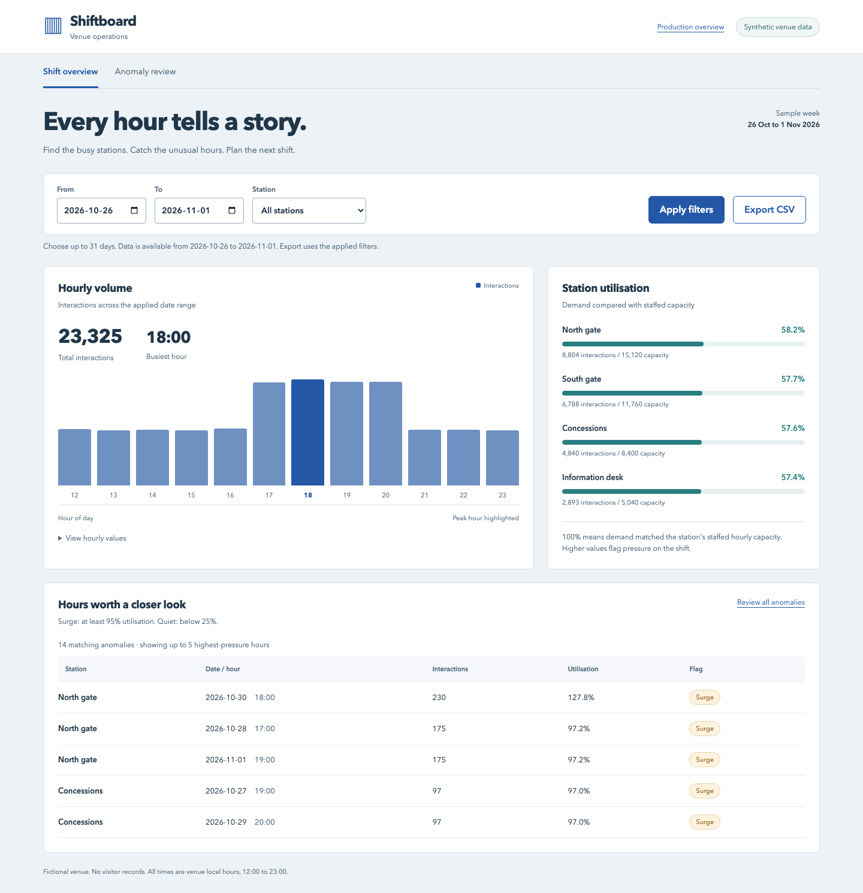

# Shiftboard

I built a venue operations dashboard because I wanted to see where a busy shift needed attention without sorting through rows of counts. A daily total can hide a crowded entrance or a quiet service desk. I wanted to compare the hours and stations together, then take the same filtered numbers into a spreadsheet.

I can choose dates and a station, see when activity peaked, compare demand with staffing capacity, and review unusual hours. Each panel has its own loading message and retry button, so one failed request does not hide everything else. **All data is fictional:** seven days, four stations, and 336 station-hour records. No visitor or staff information is collected.

To try it locally, install [Node.js 24](https://nodejs.org/), then run:

```sh
git clone https://github.com/jackaI1/angular-express-ops-dashboard.git
cd angular-express-ops-dashboard
npm ci
npm run seed
npm run build
npm start
```

Open **http://127.0.0.1:3000/venue/** for the shiftboard. **Production overview** at the root address keeps the existing production dashboard available, including its output totals, SQLite database, filters and record pagination. Each dashboard links to the other. Stop the app with Ctrl+C.



## How I use it

1. On **Shift overview**, choose dates between **26 October and 1 November 2026**, select a station, and click **Apply filters**. The default view covers the whole sample week: **23,325 interactions**.
2. Read **Hourly volume** to find the busiest hour. Each bar combines that hour across the selected dates. Open **View hourly values** for the same numbers in a table.
3. Compare **Station utilisation**, meaning demand divided by staffed handling capacity. A value above 100% means demand exceeded that capacity, not that a machine ran for more than an hour.
4. Open **Anomaly review** to see every flagged hour. Use **Show** to separate surges from quiet hours. The Friday 18:00 North gate surge reaches **127.8%**, while Wednesday 14:00 at the Information desk is unusually quiet.
5. Click **Export CSV** to download a spreadsheet file containing the station-hour rows behind the applied filters. Edits only take effect after **Apply filters**. The export includes all matching rows, including ordinary hours, regardless of the anomaly review's Show setting.

The address bar keeps the applied dates and station. I can copy a link or reload either page without losing that selection. Dates outside the sample week produce a clear empty state. Invalid dates and ranges longer than 31 days are rejected.

## How I put it together

I used Angular standalone components, which keep each screen and its dependencies together. Routing gives the overview and anomaly review their own addresses. My typed reactive form checks the date range before applying it.

The data service uses RxJS, a library for handling changing values over time. When I apply new filters, `switchMap` cancels requests for the old selection. The three panels make independent HTTP requests, with separate loading, error, and retry states. An Express.js API validates the same filters, calculates the chart totals, and generates the CSV. Express also serves the built dashboard, so running the production app only needs one process.

I kept the hourly chart in HTML and CSS rather than adding a chart package. The labels, hourly table, keyboard focus, and mobile layout make the values usable without relying on colour or hovering.

The [design notes](docs/design.md) explain the calculations, request lifecycle, API routes, and tradeoffs. The records are generated in [server/data.mjs](server/data.mjs); the shared TypeScript response shapes are in [shared/models.ts](shared/models.ts).

## Development and checks

```sh
npm ci
npx playwright install chromium
npm run dev             # Production at :4200, venue at :4201/venue/, shared API at :3000
npm run lint
npm test                # API tests and Angular Jasmine/Karma tests
npm run build
npm run test:e2e         # Venue app, Chromium desktop and mobile viewports
npm run test:smoke       # Existing seeded production HTTP journey
npm run test:browser     # Existing production browser journey
```

On Linux, use `npx playwright install --with-deps chromium` to install browser dependencies too. `npm run test:e2e` starts its own server on **4173** and stops it afterwards; build first. Ctrl+C stops all three development processes. The built server at port 3000 connects both dashboards; the development servers work on their own screens. I record their process IDs, start times, ports, and cleanup commands in ignored `.runtime/` files.

GitHub Actions runs lint, **52 API tests**, **34 Angular unit tests**, the production build, and **22 venue browser tests**, the existing production browser journey, and a clean-start smoke scenario on changes and on `main`. Browser checks use the real Express API for filtering, routing, downloads, and empty states; controlled request failures check the individual loading and retry behaviour. Failed browser runs upload traces for debugging.

## Production dashboard

The production screen at **http://127.0.0.1:3000/** compares output, rejects and stopped time across 180 fictional runs. Its date, production-line and status filters, paginated records, SQLite storage, validation and rate limiting remain available. I kept its [walkthrough](docs/production.md), [API contract](docs/api.md), [design notes](docs/production-design.md), tests and browser journey alongside the venue view. `npm run seed` refreshes only demo rows; `DATABASE_PATH` selects a separate local database.

## Limits I kept explicit

This is a local demonstration with deterministic sample data, not a live venue monitoring service. The anomaly rules are fixed thresholds: at least 95% utilisation is a surge, and below 25% is quiet. They flag hours to investigate rather than diagnosing a staffing problem. The venue sample is generated in memory; the production sample uses SQLite. Neither view has authentication or live event ingestion. The server binds to the local computer by default.
